  <picture>
    <source media="(max-width: 600px)" srcset="./assets/banner-mobile.svg" />
    
  </picture>

<h3 align="center">AI Research Engineer</h3>

  Applied AI, agentic AI, and text-to-image — 
  training, inference, comparison, evaluation, and optimization.

  <samp>applied ai &nbsp;·&nbsp; agentic ai &nbsp;·&nbsp; text-to-image &nbsp;·&nbsp; open source</samp>

### 🤖 Agentic AI

Production agents · source is private.

- **Seller Analysis Agent** — Seller trust analysis.

- **Seller & Product Deep Search Agent** — Seller and brand research across the web.

- **Price Analysis Agent** — Product price analysis across markets.

- **Lumos** — Paper and deep research agent.

### 🔎 I2T models & training

Production services · source is private.

- **Permit Reader** — Vehicle registration document reading.

- **Plate Reader** — License plate recognition.

- **Specimen Signature Reader** — Specimen signature document reading.

### 📚 Model & Architecture Catalogs

- **[Awesome Text-to-Image Architectures](https://github.com/gorkemgul/awesome-text-to-image-architectures)** — A visual catalog of text-to-image architectures with model diagrams, concise descriptions, and primary sources.

### 🛠️ Tools

- **[MCP Rig](https://github.com/gorkemgul/mcp-rig)** — Deterministic, CI-ready testing for MCP servers: YAML suites, state checks, snapshots, and JUnit reports.

### 🌱 Earlier packages

- **Detection:** [YOLOv1](https://github.com/gorkemgul/yolov1) · [YOLOv3](https://github.com/gorkemgul/yolov3) · [YOLOv5](https://github.com/native-ai/Yolov5) · YOLOv8
- **Segmentation:** [UNet](https://github.com/gorkemgul/PyTorch-UNET) · SegNet
- **Classification:** [VGG-Hub](https://github.com/gorkemgul/VGG-Hub)
- **Generative:** [PyTorch-GANs](https://github.com/native-ai/PyTorch-GANs)